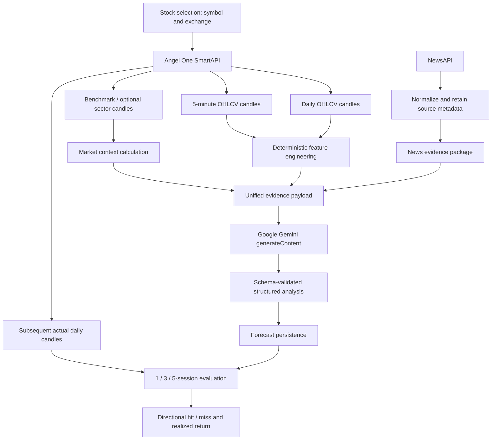
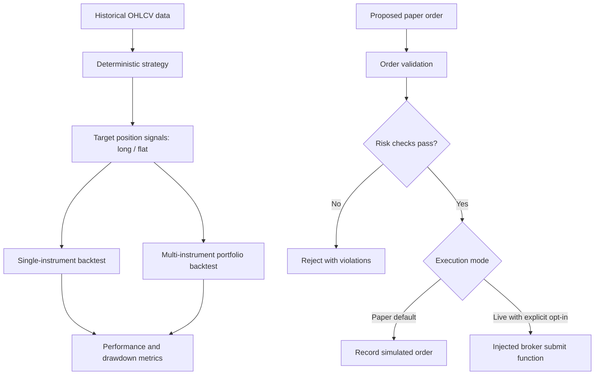

# GenAI Trading Engine

**A dual-workflow trading research platform combining Gemini-powered market intelligence with deterministic strategy backtesting and risk-controlled paper execution.**

The engine brings two complementary workflows into one Python-free, Node.js platform for Indian equities:

1. **GenAI research workflow** — collects market, technical, benchmark/sector and news evidence, then uses Google Gemini to produce a structured, explainable market outlook and tracks the forecast against subsequent prices.
2. **Quantitative trading workflow** — generates deterministic strategy signals, simulates portfolio performance with transaction costs, applies position/order risk checks, and supports paper execution by default.

> **Important distinction:** Gemini currently provides market research and directional forecasts. The deterministic strategy/backtesting and paper-execution modules are separate; Gemini forecasts are not automatically converted into trading orders. The execution adapter defaults to simulation and does not place broker orders. This is experimental research software, not investment advice.

---

## Product overview

| Workflow | Purpose | Core components | Output |
|---|---|---|---|
| **GenAI market intelligence** | Interpret market evidence and form a short-horizon outlook | Angel One SmartAPI, technical indicators, benchmark/sector context, NewsAPI, Gemini | Structured bullish/bearish/neutral analysis and forecast record |
| **Quantitative strategy & paper trading** | Test deterministic rules and simulate risk-controlled orders | SMA crossover, backtesting, portfolio simulation, risk checks, execution adapter | Trades, equity curve, performance metrics and simulated orders |

## System architecture

### 1. GenAI market intelligence pipeline

This workflow uses Gemini as the reasoning and synthesis layer. The application—not the LLM—retrieves and validates the underlying market data and calculates the technical indicators.



**What the AI does**
- Synthesizes daily and five-minute price/volume context with calculated technical indicators.
- Interprets benchmark and optional sector performance alongside the stock.
- Reviews recent news articles with publisher, title, URL and publication time.
- Produces structured outlook, horizon, subjective directional probability estimate, confidence label, evidence, risks, approximate support/resistance and invalidation conditions.
- Explicitly reports missing evidence and data limitations.

**What remains deterministic**
- Candle validation and feature engineering.
- SMA, EMA, RSI, ATR, volume and price-change calculations.
- Benchmark/sector return and range calculations.
- JSON/schema validation of the Gemini response.
- Forecast storage and comparison with future observed closes.

Gemini's probability is a subjective model estimate, not a statistically calibrated probability. The model is instructed to use only the supplied evidence and not invent prices, news or indicators.

### 2. Quantitative strategy, backtesting and paper-execution pipeline

This workflow is deliberately separate from the Gemini analysis pipeline. Signals are generated by deterministic strategy logic and tested without look-ahead by executing a close-derived signal at the next bar's open.



**Trading and risk capabilities**
- SMA-crossover target-position signals (long/flat).
- Single-instrument backtesting with next-bar-open execution.
- Multi-instrument, shared-cash portfolio simulation.
- Configurable fees and slippage assumptions.
- Equity curve, total return, drawdown and trade-level results.
- Position sizing based on risk budget, stop distance, notional cap and lot size.
- Order checks for maximum notional and available capital.
- Paper execution by default; simulated orders are recorded in memory by the execution adapter.

**Live execution safety:** live mode requires an explicit `allowLiveOrders: true` opt-in and an injected `submitOrder` function. The repository does not currently wire this adapter to Angel One order placement. Do not treat the live-mode interface as a broker-integrated live trading feature.

---

## End-to-end workflows

### GenAI analysis

1. Select an NSE/BSE symbol and provide its company name where useful for news relevance.
2. Retrieve daily and five-minute OHLCV candles from Angel One SmartAPI.
3. Calculate indicators and recent price/volume features locally.
4. Optionally retrieve NIFTY 50 and a caller-specified sector index.
5. Optionally retrieve and normalize recent NewsAPI articles.
6. Build a single evidence payload and submit it to Gemini.
7. Validate the structured response and optionally persist the forecast.
8. Run the evaluator after subsequent sessions to compare the forecast with actual closes at +1, +3 and +5 sessions.

### Strategy research and simulation

1. Supply historical bars and deterministic strategy signals.
2. Run a single-symbol or shared-cash portfolio backtest.
3. Model fees and slippage; signals from a completed close execute at the next bar open.
4. Review equity curve, returns, drawdown, trades and skipped orders.
5. For an individual proposed order, apply position/order risk checks before paper simulation.

---

## Technology stack

- **Runtime:** Node.js (ES modules)
- **GenAI:** Google Gemini API (`generateContent`, structured JSON response schema)
- **Market data:** Angel One SmartAPI
- **News enrichment:** NewsAPI (optional)
- **Quantitative analysis:** custom SMA, EMA, RSI, true range and ATR utilities
- **Research persistence:** local JSON forecast store
- **Testing:** Node.js built-in test runner
- **CI:** GitHub Actions

## Repository map

| Module | Responsibility |
|---|---|
| `stock-analysis.js` | Orchestrates market data, context, news, Gemini analysis and forecast persistence |
| `gemini-analysis.js` | Feature payload construction, Gemini API request and response validation |
| `market-context.js` | Benchmark and sector candle validation and relative-return summaries |
| `news.js` | NewsAPI retrieval and article normalization |
| `prediction-tracker.js` | Forecast persistence and 1/3/5-session outcome evaluation |
| `historicaldata.js` | Timestamped daily and five-minute candle retrieval |
| `indicator.js` | SMA, EMA, RSI, true range and ATR |
| `strategy.js` | Deterministic SMA-crossover target-position signals |
| `backtest.js` | Single-instrument next-bar-open backtesting |
| `portfolio-backtest.js` | Multi-instrument shared-cash portfolio simulation |
| `risk.js` | Position sizing and order-risk validation |
| `execution.js` | Paper-first execution adapter and explicit live-mode guard |
| `performance.js` | Return, drawdown and trade-performance metrics |
| `main.js`, `utlis.js` | SmartAPI session, scrip master, token resolution and IST utilities |
| `test/` | Unit and integration tests with injected/mocked external dependencies |

---

## Quick start

### Requirements

- Node.js 20+
- npm
- Angel One SmartAPI credentials for broker-connected market data
- Gemini API key
- NewsAPI key for news enrichment (optional)

Install dependencies and run tests:

```bash
npm ci
npm test
```

Configure credentials in your shell or deployment environment:

```bash
ANGEL_API_KEY=your_angel_api_key
ANGEL_CLIENT_CODE=your_client_code
ANGEL_MPIN=your_mpin
ANGEL_TOTP_SECRET=your_base32_totp_secret

GEMINI_API_KEY=your_gemini_api_key
GEMINI_MODEL=gemini-3.8-flash

NEWSAPI_KEY=your_newsapi_key
PREDICTION_STORE_PATH=./data/predictions.json
```

`NEWSAPI_KEY` is optional. Without it, the AI workflow runs with news marked unavailable. The prediction store defaults to `./data/predictions.json`; the `data/` directory is git-ignored. This project does not load `.env` automatically. Never commit API keys, MPINs, TOTP secrets, access tokens or feed tokens.

### Run Gemini-powered stock analysis

```js
import { analyzeStock } from "./index.js";

const result = await analyzeStock({
  symbol: "RELIANCE",
  exchange: "NSE",
  companyName: "Reliance Industries",
});

console.dir(result.analysis, { depth: null });
console.log("Saved forecast:", result.prediction);
```

To include an explicit sector index:

```js
const result = await analyzeStock({
  symbol: "INFY",
  exchange: "NSE",
  companyName: "Infosys",
  marketContextSymbols: {
    benchmark: "Nifty 50",
    sector: "Nifty IT",
  },
});
```

### Evaluate saved AI forecasts

```js
import { evaluateStockPredictions, listPredictions } from "./index.js";

const evaluation = await evaluateStockPredictions();
console.log(evaluation);

const forecasts = await listPredictions();
console.dir(forecasts, { depth: null });
```

Evaluation is an explicit function call. Schedule it after market close using your own job runner if recurring evaluation is required.

### Run deterministic strategy backtesting

```js
import {
  smaCrossoverSignals,
  runBacktest,
  summarizeBacktest,
} from "./index.js";

const bars = [
  { open: 100, close: 101 },
  { open: 102, close: 103 },
  { open: 104, close: 102 },
  { open: 101, close: 105 },
  { open: 106, close: 108 },
];

const signals = smaCrossoverSignals(
  bars.map((bar) => bar.close),
  { fastPeriod: 2, slowPeriod: 3 },
);

const result = runBacktest({
  bars,
  signals,
  initialCapital: 100_000,
  quantity: 1,
  feeBps: 5,
  slippageBps: 2,
});

console.log(summarizeBacktest(result, { periodsPerYear: 252 }));
```

### Simulate a paper order

```js
import { createExecutionAdapter } from "./index.js";

const execution = createExecutionAdapter({
  mode: "paper",
  maxOrderNotional: 25_000,
  availableCapital: 100_000,
});

const result = await execution.placeOrder({
  symbol: "RELIANCE",
  side: "BUY",
  quantity: 1,
  price: 1_250,
});

console.log(result);
console.log(execution.getPaperOrders());
```

The paper adapter validates risk limits and records a simulated order. It does not contact a broker or model actual fills.

---

## Public API

- `analyzeStock(options)` — retrieve evidence, call Gemini and optionally save a forecast.
- `evaluateStockPredictions(options?)` — evaluate saved forecasts using fresh daily candles.
- `buildStockAnalysisPayload(options)` / `analyzeStockDataWithGemini(payload, options?)` — lower-level AI analysis functions.
- `buildMarketContext(options)` — summarize benchmark and sector candles.
- `fetchStockNews(options)` / `normalizeNewsArticles(articles)` — news retrieval and normalization.
- `recordPrediction(options)`, `evaluatePendingPredictions(options)`, `listPredictions(options?)` — forecast persistence/evaluation.
- `smaCrossoverSignals(closes, options?)` — deterministic strategy signals.
- `runBacktest(options)`, `runPortfolioBacktest(options)` — strategy and portfolio simulations.
- `calculatePositionSize(options)`, `validateOrderRisk(options)` — risk utilities.
- `createExecutionAdapter(options)` — paper-first order simulation adapter.
- `sma(values, period)`, `ema(values, period)`, `rsi(values, period)`, `trueRange(highs, lows, closes)`, `atr(highs, lows, closes, period)` — indicators.
- `summarizeBacktest(result, options?)` — performance metrics.
- `smartConnect(options?)`, `clearSmartSession()`, `downloadScripMaster(...)`, `findSymbolToken(...)`, `formatToIST(date)` — broker/session utilities.

---

## Engineering boundaries and limitations

- **AI is advisory:** Gemini produces research analysis; it does not currently generate or submit strategy orders.
- **No calibrated prediction claim:** directional probability is a subjective model estimate. Forecast tracking currently records simple direction hit/miss and realized return, not full statistical calibration.
- **Data scope:** the workflow does not currently include full fundamentals, corporate filings, market breadth, institutional flows, options positioning or full order-book depth.
- **Market context:** benchmark defaults to NIFTY 50 in the broker-connected workflow; sector context must be supplied explicitly and resolved through the scrip master.
- **News quality:** articles are external source material, not verified disclosures. Relevance and coverage depend on the NewsAPI query and plan.
- **Forecast timing:** run after market close for consistent session definitions. An in-progress daily candle can affect the reference close.
- **Backtest assumptions:** long/flat, fixed quantity, next-bar-open execution, modeled fees/slippage. No margin, shorts, partial fills, taxes, financing, dividends, corporate actions or market impact.
- **Portfolio simulation:** long-only shared-cash model; no leverage, shorts, rebalancing or asynchronous fills.
- **Execution:** paper mode is in-memory simulation. Live mode requires explicit opt-in and an injected submit function; no broker order route is wired in this repository.
- **External dependencies:** broker, news and Gemini services can be delayed, rate-limited, unavailable or return incomplete data.

## Roadmap

- [x] Gemini structured analysis over daily/intraday candles and indicators.
- [x] Benchmark and optional sector context.
- [x] News enrichment with source metadata.
- [x] Forecast persistence and 1/3/5-session outcome tracking.
- [x] Deterministic strategy signals and backtesting.
- [x] Multi-instrument shared-cash portfolio simulation.
- [x] Risk validation and paper-first execution adapter.
- [x] Automated test suite and GitHub Actions CI.
- [ ] Connect AI forecasts to a separately defined, deterministic signal policy with explicit validation (not direct free-form LLM order execution).
- [ ] Add exchange-calendar-aware evaluation and robust historical windows.
- [ ] Add Brier score, calibration curves and benchmark-relative forecast reporting.
- [ ] Add persistent paper-order ledger, fill/slippage simulation and portfolio-level risk controls.
- [ ] Add observability, retry/backoff policies and provider health metrics.

## Disclaimer

For educational and engineering experimentation only. Nothing in this repository is investment advice or a recommendation to buy, sell or hold a security. Historical backtests and model-generated forecasts do not guarantee future results. Independently validate data quality, news sources, broker terms, exchange rules and model behavior before making financial decisions.
