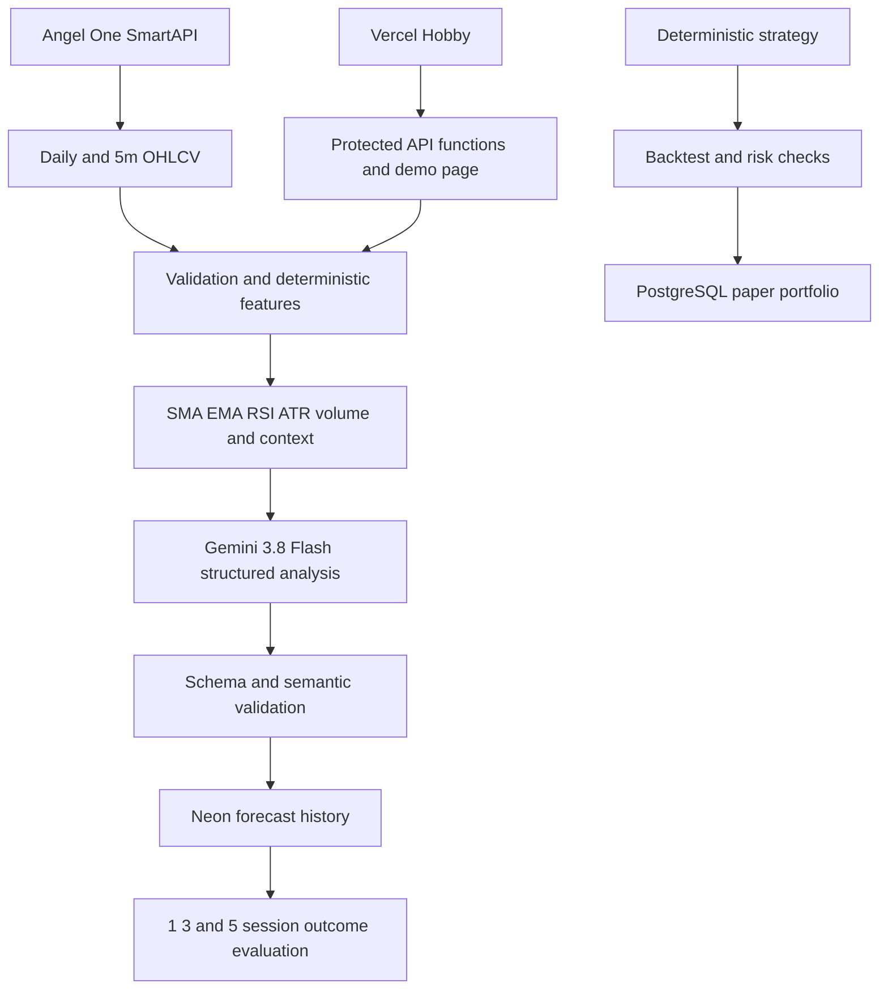

# GenAI Trading Engine

An AI-assisted **Indian equity research and paper-trading system** built with Node.js, Gemini 3.8 Flash, Angel One SmartAPI, Neon PostgreSQL and Vercel Functions.

It separates deterministic quantitative calculations from LLM interpretation. The LLM explains supplied evidence; it does not calculate indicators, invent market data or place trades.

> **Safety boundary:** research and paper trading only. No live Angel One order placement is implemented or enabled. Forecasts are not investment advice and do not establish profitability.

## Architecture



## Why Gemini 3.8 Flash?

The project needs instruction following, structured JSON output and evidence-based synthesis—not a model trained to predict stock prices. Gemini 3.8 Flash supports structured outputs and offers a managed API, avoiding the operational cost and complexity of hosting model weights. Its free tier is suitable for a low-volume portfolio demonstration, subject to Google's quotas and terms.

This is an engineering trade-off, **not a claim that Gemini is the most accurate stock forecaster**. Assess model quality through out-of-sample outcomes, directional accuracy, Brier score, log loss and calibration. The model's stated directional probability is uncalibrated until enough evaluation data exist.

## Capabilities

- Angel One daily and 5-minute market data with chronological, duplicate and freshness checks.
- Deterministic SMA, EMA, RSI, ATR, price-change, range and volume features.
- Optional benchmark/sector context and NewsAPI enrichment.
- Gemini structured analysis with strict field, direction, probability and price-level validation.
- PostgreSQL forecast history and 1-, 3- and 5-session outcome evaluation.
- Deterministic SMA-crossover backtesting, cash constraints, costs, position sizing and risk checks.
- Durable PostgreSQL paper portfolio with orders, fills, positions, fees, realized/unrealized P&L and equity snapshots.
- Vercel serverless analysis API and minimal demo page protected by a server-side demo key.

## Stack

| Layer | Technology |
|---|---|
| Application/API | Node.js 20+, Vercel Functions |
| LLM | Gemini 3.8 Flash (`gemini-3.8-flash`) |
| Market data | Angel One SmartAPI |
| Persistence | Neon PostgreSQL |
| Indicators | Local deterministic JavaScript |
| News | NewsAPI (optional) |
| CI / validation | GitHub Actions, Node test runner |

## Local setup

1. Install Node.js 20 or later.
2. Copy `.env.example` to `.env` and fill credentials locally.
3. Install dependencies and run tests:

```bash
npm ci
npm test
npm run db:migrate
```

Required environment variables:

```dotenv
DATABASE_URL=                 # Neon pooled URL for app traffic
DATABASE_URL_UNPOOLED=        # Neon direct URL for migrations
ANGEL_API_KEY=
ANGEL_CLIENT_CODE=
ANGEL_MPIN=
ANGEL_TOTP_SECRET=
GEMINI_API_KEY=
GEMINI_MODEL=gemini-3.8-flash
DEMO_API_KEY=                 # long random value for the Vercel demo
NEWSAPI_KEY=                  # optional
PG_POOL_MAX=5
```

The project does not load `.env` automatically. Never commit credentials. The root-level `config.js` is ignored because legacy local setups may store broker credentials there; use the environment variables above instead. If a credential has ever been committed, revoke or rotate it with the provider—deleting the file does not remove it from Git history. NewsAPI is optional.

## Vercel Hobby deployment

The repository includes a static demo at `public/index.html`, `GET /api/health`, and a protected `POST /api/analyze` function. Vercel Hobby is designed for personal, non-commercial use and is subject to usage and function limits.

1. Import this GitHub repository into Vercel.
2. Keep the project root at the repository root and use the Node.js runtime.
3. Add `DATABASE_URL`, `ANGEL_API_KEY`, `ANGEL_CLIENT_CODE`, `ANGEL_MPIN`, `ANGEL_TOTP_SECRET`, `GEMINI_API_KEY`, `GEMINI_MODEL`, and `DEMO_API_KEY` in Vercel Project Settings → Environment Variables.
4. Generate a long random `DEMO_API_KEY`. Enter it only in the demo page's password field when running an analysis.
5. Deploy. Check `/api/health`, then open the project URL.
6. Never expose Gemini, Angel One or Neon credentials to browser code.

The API requires `Authorization: Bearer <DEMO_API_KEY>`, accepts only POST requests and validates NSE symbols. The key is checked server-side using a constant-time comparison. The page does not persist the key. This endpoint is for a private, low-volume portfolio demo; it does not claim globally consistent rate limiting because serverless instances are ephemeral.

Vercel Hobby and Gemini free-tier quotas can be exhausted. Requests may be unavailable until quotas reset. There is **no paid fallback**, no secondary model provider and no automatic model switching.

## GitHub Actions live validation

The manual workflow `Live Market + Gemini Validation` runs read-only Angel One market-data retrieval, calls Gemini and writes forecast records to Neon. It does not submit broker orders.

Add these repository Actions secrets:

- `DATABASE_URL`
- `DATABASE_URL_UNPOOLED`
- `ANGEL_API_KEY`
- `ANGEL_CLIENT_CODE`
- `ANGEL_MPIN`
- `ANGEL_TOTP_SECRET`
- `GEMINI_API_KEY`

Optional repository variable: `GEMINI_MODEL` (defaults to `gemini-3.8-flash`). NewsAPI is optional.

Then open Actions → Live Market + Gemini Validation → Run workflow. Start with one NSE symbol. The runner applies migrations, fetches candles, validates the response and persists the forecast. This consumes provider quotas and writes forecast records to the configured database.

## Forecast evaluation and honesty

- `directionalProbabilityPct` is a subjective estimate that the stated direction will be correct over the forecast horizon; it is not calibrated.
- NEUTRAL uses 50%; directional calls are constrained to 50–90%.
- Returns within ±0.10% are classified as NEUTRAL for outcome scoring.
- A successful API response proves integration, not predictive skill.
- Use chronological walk-forward splits; never tune against the final holdout.
- Compare against a deterministic baseline and report sample size, accuracy, Brier score, log loss and calibration before making performance claims.

## Important limitations

- Broker freshness uses an NSE weekday/session approximation, not an official exchange holiday calendar.
- News coverage depends on NewsAPI plan/query and is optional.
- Backtests simplify fills, taxes, slippage, market impact and corporate actions.
- Vercel Hobby and Gemini free usage are quota-limited; this is a low-volume demo, not an always-on trading service.
- Live order placement remains disabled.

## Disclaimer

For educational and engineering experimentation only. Nothing here is investment advice or a recommendation to buy, sell or hold any security. Historical tests and AI-generated analysis do not guarantee future results.
