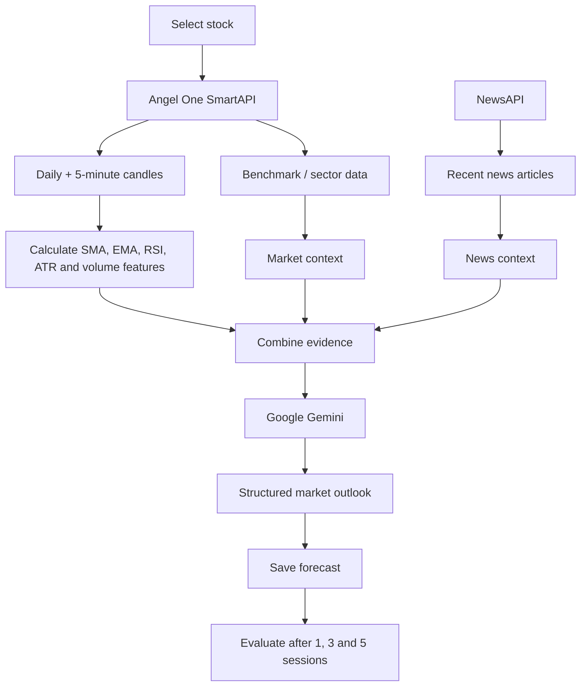
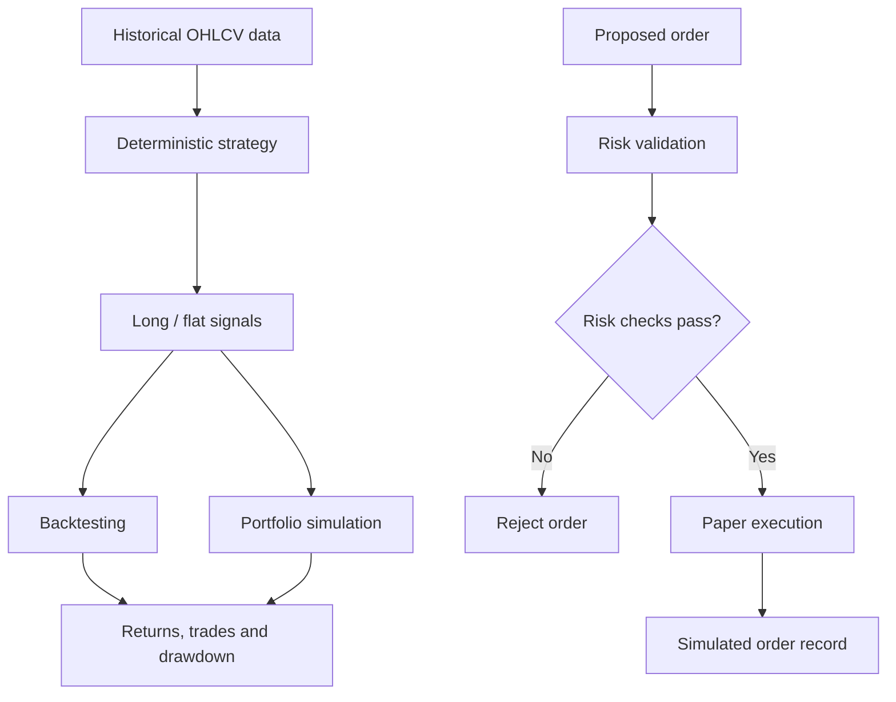

# GenAI Trading Engine

A dual-workflow market research and paper-trading project for Indian equities, built with **Node.js, Google Gemini, and Angel One SmartAPI**.

It combines:
- **GenAI market analysis:** Gemini interprets technical indicators, benchmark/sector context and recent news to produce a structured market outlook.
- **Quantitative trading:** deterministic strategies, backtesting, portfolio simulation, risk checks and paper-order simulation.

> **Important:** Gemini currently provides research and forecasts. It does not automatically generate or execute trading orders. The strategy and paper-execution workflow is separate. Paper mode is the default; the current project does not connect the execution adapter to Angel One order placement. This is an experimental project, not investment advice.

---

## How it works

### 1. GenAI market analysis



The application retrieves and validates the data and calculates indicators. **Gemini is the AI reasoning layer**: it combines the supplied evidence and returns a bullish, bearish or neutral outlook, a 1–5 session horizon, a subjective directional probability estimate, confidence, supporting factors, risks and invalidation conditions.

Forecasts can be stored and later compared with actual prices. The probability is a model estimate, not a statistically calibrated probability.

### 2. Quantitative strategy and paper trading



This workflow does not depend on Gemini. It uses deterministic SMA-crossover signals, next-bar-open backtesting, shared-cash portfolio simulation, fee/slippage assumptions, position sizing and order-risk checks. Paper orders are simulated in memory; no real broker order is placed.

---

## Tech stack

- **Runtime:** Node.js (ES modules)
- **GenAI:** Google Gemini API with structured JSON output
- **Market data:** Angel One SmartAPI
- **News:** NewsAPI (optional)
- **Indicators:** SMA, EMA, RSI, ATR and volume features
- **Trading research:** strategy signals, backtesting and portfolio simulation
- **Risk:** position sizing and order validation
- **Testing / CI:** Node.js test runner and GitHub Actions

## Quick start

### Requirements

- Node.js 20+
- Angel One SmartAPI credentials
- Gemini API key
- NewsAPI key (optional)

Install and run tests:

```bash
npm ci
npm test
```

Configure these environment variables in your runtime:

```bash
ANGEL_API_KEY=your_angel_api_key
ANGEL_CLIENT_CODE=your_client_code
ANGEL_MPIN=your_mpin
ANGEL_TOTP_SECRET=your_base32_totp_secret

GEMINI_API_KEY=your_gemini_api_key
GEMINI_MODEL=gemini-3.8-flash

NEWSAPI_KEY=your_newsapi_key
PREDICTION_STORE_PATH=./data/predictions.json
```

The project does not load `.env` automatically. Keep credentials out of source control. NewsAPI is optional; without it, analysis continues with news marked unavailable.

### Run AI market analysis

```js
import { analyzeStock } from "./index.js";

const result = await analyzeStock({
  symbol: "RELIANCE",
  exchange: "NSE",
  companyName: "Reliance Industries",
});

console.dir(result.analysis, { depth: null });
console.log("Saved forecast:", result.prediction);
```

To include a sector index, pass it explicitly:

```js
const result = await analyzeStock({
  symbol: "INFY",
  exchange: "NSE",
  companyName: "Infosys",
  marketContextSymbols: {
    benchmark: "Nifty 50",
    sector: "Nifty IT",
  },
});
```

### Evaluate saved forecasts

```js
import { evaluateStockPredictions, listPredictions } from "./index.js";

console.log(await evaluateStockPredictions());
console.dir(await listPredictions(), { depth: null });
```

Evaluation is an explicit function call; schedule it after market close if recurring evaluation is needed.

### Run a strategy backtest

```js
import {
  smaCrossoverSignals,
  runBacktest,
  summarizeBacktest,
} from "./index.js";

const bars = [
  { open: 100, close: 101 },
  { open: 102, close: 103 },
  { open: 104, close: 102 },
  { open: 101, close: 105 },
  { open: 106, close: 108 },
];

const signals = smaCrossoverSignals(
  bars.map((bar) => bar.close),
  { fastPeriod: 2, slowPeriod: 3 },
);

const result = runBacktest({
  bars,
  signals,
  initialCapital: 100_000,
  quantity: 1,
  feeBps: 5,
  slippageBps: 2,
});

console.log(summarizeBacktest(result, { periodsPerYear: 252 }));
```

## Main modules

| File | Purpose |
|---|---|
| `stock-analysis.js` | Coordinates market data, news, Gemini and forecast tracking |
| `gemini-analysis.js` | Builds the analysis payload and calls Gemini |
| `market-context.js` | Calculates benchmark and sector context |
| `news.js` | Retrieves and normalizes news |
| `prediction-tracker.js` | Stores and evaluates forecasts |
| `historicaldata.js` | Retrieves daily and five-minute candles |
| `indicator.js` | Technical indicator calculations |
| `strategy.js` | Deterministic SMA-crossover signals |
| `backtest.js`, `portfolio-backtest.js` | Single-stock and portfolio backtesting |
| `risk.js`, `execution.js` | Risk checks and paper execution |
| `performance.js` | Backtest performance metrics |

## Important limitations

- Gemini analysis is advisory; forecasts are not automatically turned into trades.
- Directional probabilities are subjective model estimates, not calibrated predictions.
- Sector context is optional and must be supplied explicitly.
- News coverage depends on the NewsAPI query and plan; verify original sources.
- Backtests use simplified assumptions and do not model all real-world trading costs, fills, taxes or market impact.
- Paper execution is simulation only. The live adapter requires explicit opt-in and an injected submit function; it is not wired to broker order placement.

## Disclaimer

For educational and engineering experimentation only. Nothing in this repository is investment advice or a recommendation to buy, sell or hold a security. Historical backtests and AI-generated forecasts do not guarantee future results.
