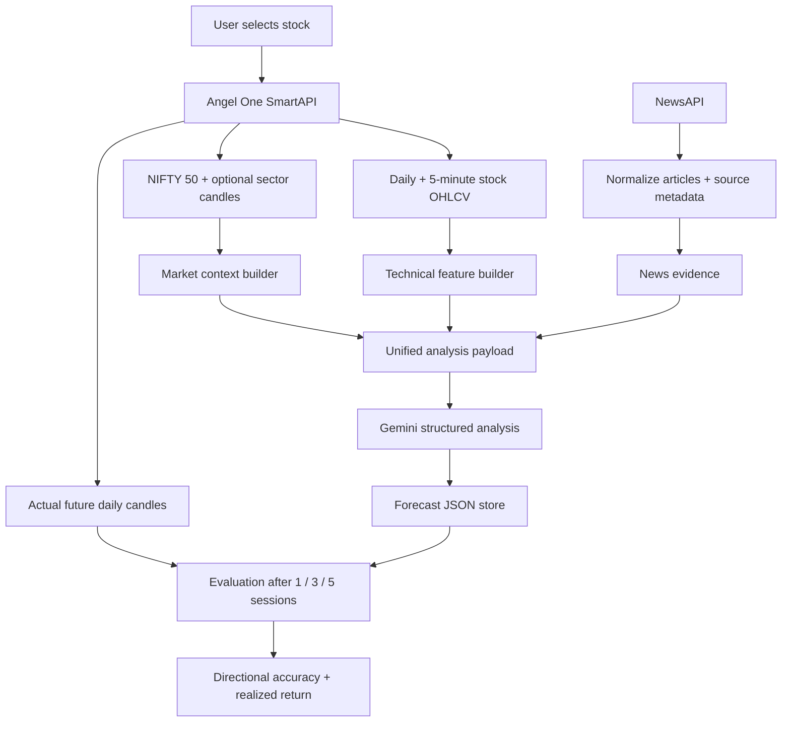

# GenAI Trading Engine

A Gemini-powered stock research and forecast-tracking engine for Indian equities. It combines Angel One SmartAPI price data, benchmark/sector context, sourced company news, technical indicators and Gemini's structured analysis. Every successful forecast can be persisted and later scored against actual closes after 1, 3 and 5 trading sessions.

> **Project status:** Experimental research software. This is not a production trading platform, a calibrated forecasting model, or investment advice. It does not automatically place orders. Broker data, exchange calendars, news coverage, rate limits and API availability can affect results.

## What this project does

For a selected NSE/BSE stock, the primary workflow:

1. Resolves the instrument and fetches timestamped daily and five-minute OHLCV candles from Angel One.
2. Calculates technical features: SMA(10/20), EMA(9/20), RSI(14), ATR(14), volume context, recent range and percentage changes.
3. Adds broader market context: NIFTY 50 benchmark trend by default, and an optional sector index supplied by the caller.
4. Retrieves recent stock/company articles from NewsAPI when `NEWSAPI_KEY` is configured. Article source, title, publication time and URL are retained.
5. Sends the complete evidence package to Gemini for structured bullish/bearish/neutral analysis, with an explicit separation between supplied facts and model interpretation.
6. Saves the forecast, model probability estimate and reference close to a local JSON store.
7. Evaluates saved forecasts against actual daily closes after 1, 3 and 5 subsequent sessions when the evaluation function is run.

The repository also contains deterministic strategy research, risk sizing, backtesting, portfolio simulation and a guarded paper/live execution boundary. Those utilities are separate from the Gemini research workflow.

## Architecture and data flow



### Module responsibilities

| File | Responsibility |
|---|---|
| `index.js` | Public API exports |
| `main.js` | Angel One session lifecycle |
| `utlis.js` | Scrip-master cache, exact token resolution, IST formatting |
| `historicaldata.js` | Daily and five-minute timestamped candle retrieval |
| `indicator.js` | SMA, EMA, RSI, true range and ATR |
| `market-context.js` | Benchmark and sector index trend/range summaries |
| `news.js` | NewsAPI retrieval and article normalization |
| `gemini-analysis.js` | Stock features, combined evidence payload and Gemini structured output |
| `stock-analysis.js` | End-to-end data/context/news/Gemini workflow and forecast tracking |
| `prediction-tracker.js` | Persistent forecast history and 1/3/5-session outcome evaluation |
| `strategy.js` | Deterministic SMA-crossover target-position signals |
| `risk.js` | Risk-based position sizing and order-risk checks |
| `backtest.js` | Long/flat next-bar-open backtesting with costs |
| `performance.js` | CAGR, volatility, Sharpe, drawdown, win rate and profit factor |
| `portfolio-backtest.js` | Multi-instrument shared-cash simulation |
| `execution.js` | Paper-first execution adapter with explicit live-mode guard |
| `midprice.js` | Derived candle mid-price series |
| `test/` | Unit and integration tests using mocked external APIs |

## Setup

### Requirements

- Node.js 20+
- npm
- Angel One SmartAPI credentials for broker-connected market data
- Gemini API key
- NewsAPI key for news enrichment (optional but recommended)

Install and test:

```bash
npm ci
npm test
```

Set environment variables in your shell or deployment environment:

```bash
ANGEL_API_KEY=your_angel_api_key
ANGEL_CLIENT_CODE=your_client_code
ANGEL_MPIN=your_mpin
ANGEL_TOTP_SECRET=your_base32_totp_secret

GEMINI_API_KEY=your_gemini_api_key
GEMINI_MODEL=gemini-3.8-flash

NEWSAPI_KEY=your_newsapi_key
PREDICTION_STORE_PATH=./data/predictions.json
```

`NEWSAPI_KEY` is optional. Without it, analysis still runs but the Gemini payload explicitly indicates that news is unavailable. The prediction store defaults to `./data/predictions.json`; the `data/` directory is git-ignored. Do not commit API keys, MPINs, TOTP secrets, access tokens or feed tokens. This project does not load `.env` automatically.

## Run Gemini stock analysis

```js
import { analyzeStock } from "./index.js";

const result = await analyzeStock({
  symbol: "RELIANCE",
  exchange: "NSE",
  companyName: "Reliance Industries",
});

console.dir(result.analysis, { depth: null });
console.log("Saved forecast:", result.prediction);
```

By default the workflow attempts to fetch NIFTY 50 candles as benchmark context. You can add a sector index explicitly (use an exact instrument name resolvable in the Angel One scrip master):

```js
const result = await analyzeStock({
  symbol: "INFY",
  exchange: "NSE",
  companyName: "Infosys",
  marketContextSymbols: {
    benchmark: "Nifty 50",
    sector: "Nifty IT",
  },
});
```

You can also inject pre-fetched data for deterministic tests or alternate providers:

```js
const result = await analyzeStock({
  symbol: "RELIANCE",
  exchange: "NSE",
  dailyCandles,       // [timestamp, open, high, low, close, volume][]
  intradayCandles,    // five-minute rows in the same format
  marketContext,      // optional object built by buildMarketContext()
  news,               // optional normalized news package
  trackPrediction: false,
});
```

### What Gemini receives

- Latest 20 daily and 20 five-minute OHLCV candles.
- SMA(10/20), EMA(9/20), RSI(14), ATR(14), ATR as a percentage of price, volume context, percentage changes and recent highs/lows.
- Benchmark and optional sector summaries, including recent return and position in the observed range.
- Up to 12 recent NewsAPI articles with publisher, title, description, URL and publication timestamp.

Gemini returns a structured outlook, 1–5 session horizon, subjective directional probability estimate, confidence label, evidence, support/resistance estimates, invalidation condition, risks, scenario and separate market-context/news analysis.

**Data coverage matters:** this is not “all market data”. The current package does not include company financial statements, valuation, corporate filings, a complete macroeconomic dataset, market breadth, institutional flows, options positioning or full order-book depth. NewsAPI coverage and article availability depend on its plan and search results. Gemini's probability is a subjective model output, not a calibrated probability. Treat stale, missing or conflicting inputs as limitations—not as a reason to invent facts.

## Prediction tracking and evaluation

Every successful `analyzeStock()` call records a forecast by default. The record includes:

- Unique forecast ID, symbol and exchange.
- Forecast timestamp and the reference daily candle timestamp/close.
- Gemini outlook, confidence, probability estimate and full structured response.
- Pending outcome slots for 1, 3 and 5 subsequent daily sessions.

Run evaluation after new trading sessions have completed:

```js
import { evaluateStockPredictions, listPredictions } from "./index.js";

const evaluation = await evaluateStockPredictions();
console.log(evaluation);

const forecasts = await listPredictions();
console.dir(forecasts, { depth: null });
```

The evaluator compares the actual close at session +1, +3 and +5 with the saved reference close. It records realized percentage return, actual direction and whether the forecast direction was correct. The evaluator is an explicit function call; schedule it with your own daily job after the market close if you want unattended tracking. It is not automatically scheduled by this library.

**Evaluation caveats:** the current directional score is a simple hit/miss measure, not a complete forecast-quality report. It does not yet calculate Brier score, calibration curves, benchmark-adjusted returns, overlapping-forecast controls or statistical significance. Run evaluation regularly; the broker helper currently returns a limited recent candle window, so very old pending forecasts may no longer be matchable. The reference close is the latest daily candle returned by Angel One, which may be an in-progress session depending on when analysis is run—prefer running forecasts after market close for consistent session definitions.

To disable persistence for a one-off analysis or a test, pass `trackPrediction: false`.

## Strategy research and backtesting

The deterministic strategy tools are separate from Gemini forecasts. Signals are computed from a completed bar close and executed at the next bar open to reduce look-ahead bias.

```js
import { smaCrossoverSignals, runBacktest, summarizeBacktest } from "./index.js";

const bars = [
  { open: 100, close: 101 },
  { open: 102, close: 103 },
  { open: 104, close: 102 },
  { open: 101, close: 105 },
  { open: 106, close: 108 },
];

const signals = smaCrossoverSignals(bars.map((bar) => bar.close), {
  fastPeriod: 2,
  slowPeriod: 3,
});

const result = runBacktest({
  bars, signals,
  initialCapital: 100_000,
  quantity: 1,
  feeBps: 5,
  slippageBps: 2,
});

console.log(summarizeBacktest(result, { periodsPerYear: 252 }));
```

## Public API

- `analyzeStock(options)` — fetch data/context/news, run Gemini and save a forecast.
- `evaluateStockPredictions(options?)` — evaluate saved forecasts against fresh daily candles.
- `buildStockAnalysisPayload(options)` / `analyzeStockDataWithGemini(payload, options?)` — lower-level AI functions.
- `buildMarketContext(options)` — summarize benchmark and sector candles.
- `fetchStockNews(options)` / `normalizeNewsArticles(articles)` — NewsAPI integration.
- `recordPrediction(options)`, `evaluatePendingPredictions(options)`, `listPredictions(options?)` — prediction persistence/evaluation.
- `smartConnect(options?)` / `clearSmartSession()`
- `downloadScripMaster(cachePath?, options?)`, `findSymbolToken(master, exchange, symbol)`, `formatToIST(date)`
- `fetchDailyCandlesWithTimestamps(symbol, exchange)` / `fetchFiveMinuteCandlesWithTimestamps(symbol, exchange)`
- `fetchLast20DaysDailyCandles(symbol, exchange)` / `fetchLast20FiveMinCandlesRobust(symbol, exchange)`
- `sma(values, period)`, `ema(values, period)`, `rsi(values, period)`, `trueRange(highs, lows, closes)`, `atr(highs, lows, closes, period)`
- `smaCrossoverSignals(closes, options?)`
- `calculatePositionSize(options)`, `validateOrderRisk(options)`
- `runBacktest(options)`, `summarizeBacktest(result, options?)`
- `runPortfolioBacktest(options)`, `createExecutionAdapter(options)`
- `getStockMidPrices(symbol, exchange?)`

## Important assumptions and limitations

- Timestamped candle rows use `[timestamp, open, high, low, close, volume]`; legacy helpers return `[open, high, low, close, volume]`.
- Index/sector symbols must resolve exactly through the downloaded Angel One scrip master. Sector context is optional and must be configured; it is not automatically inferred for every stock.
- News is retrieved by a keyword query. Symbol-only searches can be ambiguous; pass `companyName` or `newsQuery` to improve relevance.
- News articles are external, time-stamped source material, not verified corporate disclosures. Review original links before relying on them.
- Weekend-only date handling is not a substitute for an exchange holiday calendar.
- Broker responses may be incomplete, delayed, throttled or unavailable. Validate timestamps and candle continuity.
- The mid-price `(high + low) / 2` is not an executable quote or guaranteed fill price.
- Backtesting is long/flat and does not model margin, partial fills, taxes, financing, dividends, corporate actions or market impact.
- Portfolio simulation is long-only, fixed-quantity and cash-constrained; it does not model shorts, margin, rebalancing or asynchronous fills.
- The execution adapter defaults to paper mode. Live mode requires explicit opt-in and an injected broker submit function; it is not wired to Angel One order placement.

## Roadmap

- [x] Gemini analysis of stock daily/intraday candles and indicators.
- [x] Benchmark and optional sector market context.
- [x] NewsAPI article enrichment with source and publication metadata.
- [x] Persistent forecasts and 1/3/5-session directional outcome tracking.
- [x] Unit tests for context, news normalization and prediction scoring.
- [ ] Exchange-calendar integration and robust historical data windows.
- [ ] Scheduled evaluation worker and retention/backup policy for forecast history.
- [ ] Brier score, calibration, benchmark-relative returns and cohort-level reporting.
- [ ] Better company/entity resolution and duplicate/relevance filtering for news.
- [ ] Fundamentals, filings, market breadth, macro data and corporate-event context.
- [ ] Broker response fixtures, retries, rate limiting and structured observability.

## Disclaimer

For educational and engineering experimentation only. Nothing in this project is investment advice or a recommendation to buy, sell or hold a security. Historical outcomes do not guarantee future results. Independently validate data quality, news sources, broker terms, exchange rules and model behavior before using outputs in financial decisions.
